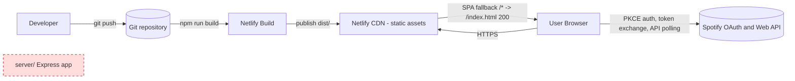

# Design Document

## Overview

This design re-architects WaveSync from a Vue 2 SPA backed by an Express OAuth server into a **fully static, serverless single-page application** deployed on Netlify. All authentication logic moves into the browser using the **Authorization Code with PKCE** flow (RFC 7636), which requires no client secret and no backend. The Express server (`server/`) and its dependencies are removed entirely.

The visualizer, the real-time sync loop, the fixed-mode home-page demo, and all rendering behavior are preserved (Requirement 6). Only the authentication and token lifecycle are replaced, plus the deployment and build configuration.

### Before (server-backed Authorization Code flow)

- `Home.vue` calls `GET {PROJECT_ROOT}/auth` to obtain an `auth_id`, then redirects to `{PROJECT_ROOT}/login`.
- The Express `login` route builds the Spotify authorize URL (with the server's `CLIENT_ID`) and redirects the browser.
- Spotify redirects to the server `callback` route, which exchanges the code using **Basic auth with a client secret**, sets `SPOTIFY_ACCESS_TOKEN` / `SPOTIFY_REFRESH_TOKEN` / `SPOTIFY_REFRESH_CODE` **cookies**, and redirects to `/visualizer`.
- `sync.js` reads those cookies, and on a 401 calls `{PROJECT_ROOT}/refresh`, which the server fulfills using the client secret.
- In production the same Express process serves the built static assets with history-API fallback.

### After (browser-only PKCE flow, static hosting)

- `Home.vue` login button calls `Auth_Module.beginAuth()`: generate a `Code_Verifier`, derive an S256 `Code_Challenge`, generate a `State_Parameter`, persist verifier + state in `sessionStorage`, build the authorize URL, and redirect the browser directly to the `Spotify_Authorize_Endpoint`.
- Spotify redirects to `/callback` (a new vue-router route). `Callback.vue` runs `Auth_Module.handleCallback()`: validate `state`, exchange the `code` for tokens via a POST to the `Spotify_Token_Endpoint` with `code_verifier` and no secret, store tokens in `sessionStorage` via `Token_Manager`, then navigate to `/visualizer`.
- `sync.js` reads the access token from `Token_Manager`. On a 401 it calls `Token_Manager.refresh()` (POST `grant_type=refresh_token`, `client_id`, no secret), then resumes polling.
- Netlify serves only static assets, with an `SPA_Fallback` rewrite (`/*  /index.html  200`) so deep links (`/visualizer`) and the OAuth redirect (`/callback`) resolve client-side.

### Architecture flow (after migration)

```mermaid
sequenceDiagram
    participant U as User
    participant B as Browser (WaveSync_App)
    participant SS as sessionStorage
    participant SA as Spotify Authorize Endpoint
    participant ST as Spotify Token Endpoint
    participant API as Spotify Web API
    participant N as Netlify (static assets + SPA fallback)

    Note over N: Serves /index.html with 200 for any unmatched path
    U->>B: Open site (Home route)
    U->>B: Click Login -> Auth_Module.beginAuth()
    B->>B: Generate code_verifier, code_challenge (S256), state (Web Crypto)
    B->>SS: Persist verifier + state
    B->>SA: Redirect to /authorize?client_id,redirect_uri,scope,code_challenge,state,...
    SA->>U: Prompt to grant playback scope
    SA->>N: Redirect to REDIRECT_URI (/callback?code&state)
    N-->>B: Serve /index.html (SPA fallback, path/query preserved)
    B->>B: Mount Callback.vue -> Auth_Module.handleCallback()
    B->>SS: Read persisted verifier + state
    B->>B: Validate returned state == persisted state
    B->>ST: POST grant_type=authorization_code, code, code_verifier, client_id (no secret)
    ST-->>B: { access_token, refresh_token, expires_in, token_type }
    B->>SS: Token_Manager stores tokens; clear verifier + state
    B->>B: router.push('/visualizer')
    loop Every 2500ms (Sync_Engine)
        B->>API: GET /me/player (Bearer access_token)
        alt 401 Unauthorized
            B->>ST: POST grant_type=refresh_token, refresh_token, client_id (no secret)
            ST-->>B: { access_token, [refresh_token] }
            B->>SS: Token_Manager stores new token(s)
        else Playing
            B->>API: GET /audio-analysis/{id}, /audio-features/{id}
            API-->>B: analysis + features -> drive visualizer
        end
    end
```

### Deployment topology



The `server/` Express application is deleted; there is no runtime backend (Requirement 10).

## Architecture

### Layering

| Layer | Module(s) | Responsibility |
| --- | --- | --- |
| Config | `src/config.js` | Read and validate `VUE_APP_SPOTIFY_CLIENT_ID` and `VUE_APP_REDIRECT_URI` at build/startup (Req 9). |
| Auth | `src/auth/pkce.js` (Auth_Module) | PKCE parameter generation, authorize URL construction, callback handling, code exchange (Req 1, 2, 3). |
| Tokens | `src/auth/tokens.js` (Token_Manager) | Store/read/clear tokens in `sessionStorage`, refresh (Req 4, 5). |
| Network | `src/util/network.js` | `get()` for Spotify API, new `post()` for form-urlencoded token calls. |
| Sync | `src/wavesync/sync.js` (Sync_Engine) | Poll playback, fetch analysis/features, drive loop; read tokens from Token_Manager; refresh on 401 (Req 5, 6). |
| View | `Home.vue`, `Callback.vue`, `Visualizer.vue`, `router.js` | UI + routing, including the new `/callback` route (Req 2, 3, 7). |

### Key design decisions

- **sessionStorage, not cookies.** Tokens live only for the tab/session and are never written to `document.cookie` (Req 4.1, 4.2, 10.5). The existing `src/util/cookie.js` is removed from the token path. (`cookie.js` also has a latent bug: `remove()` calls `this.hasItem` which does not exist — the function is named `has`. Since the cookie token path is deleted, this is retired rather than patched.)
- **No client secret in the browser.** PKCE replaces the secret with a `code_verifier`/`code_challenge` pair (Req 3.5, 5.3, 9.3).
- **Reconcile the broken import.** `Home.vue` currently imports `{ auth } from '@/wavesync/sync'`, but `sync.js` has no `auth` export — this is dead/broken. The new `Home.vue` imports `beginAuth` from the Auth_Module and drops the broken import and the `{PROJECT_ROOT}/auth` + `/login` calls.
- **Network layer.** Add a `post()` helper to `src/util/network.js` that sends `application/x-www-form-urlencoded` bodies and returns the same `{ status, data, success }` shape. The Auth_Module and Token_Manager use the native `fetch` API for token calls because `fetch` gives first-class support for request timeouts via `AbortController` (needed for the 30s exchange timeout in Req 3.9 and the 10s refresh timeout in Req 5.8) and for reading non-2xx bodies. The existing XHR `get()` is retained unchanged for Spotify Web API calls in `sync.js` to minimize risk to preserved behavior. Decision: **keep `get()` (XHR) for API polling; use `fetch` for token exchange/refresh.** A `post()` helper is still added for parity and potential reuse, but token calls standardize on `fetch` for the timeout capability.
- **Env vars.** Replace `PROJECT_ROOT`/`dotenv` with Vue CLI's built-in `VUE_APP_`-prefixed variables, which Vue CLI statically injects into the client bundle (Req 9.4).

## Components and Interfaces

### Config module — `src/config.js` (Build_Time_Config)

Reads and validates the two required build-time variables. Fails fast so a misconfigured build does not silently ship (Req 9.1, 9.2, 9.6).

```js
// src/config.js

/**
 * Reads VUE_APP_ build-time config. Vue CLI statically replaces
 * process.env.VUE_APP_* at build time.
 * @throws {Error} if a required value is absent or empty.
 */
export function loadConfig()
// returns: { clientId: string, redirectUri: string }

export const CLIENT_ID    // string  (VUE_APP_SPOTIFY_CLIENT_ID)
export const REDIRECT_URI // string  (VUE_APP_REDIRECT_URI)

// Spotify endpoints (constants, not env):
export const AUTHORIZE_ENDPOINT = 'https://accounts.spotify.com/authorize'
export const TOKEN_ENDPOINT     = 'https://accounts.spotify.com/api/token'
export const PLAYBACK_SCOPE     = 'user-read-playback-state'
```

`loadConfig()` throws if `VUE_APP_SPOTIFY_CLIENT_ID` or `VUE_APP_REDIRECT_URI` is missing or empty, naming the offending variable. It is invoked at module import (app startup) so production builds carrying missing values fail loudly. A complementary **build-time guard** is added to `vue.config.js` (see Configuration Changes) to satisfy Req 9.6 (build must *fail* when a value is missing), because `VUE_APP_` injection alone would otherwise embed `undefined` rather than erroring.

### Auth_Module — `src/auth/pkce.js`

Executes the PKCE flow entirely in the browser (Req 1, 2, 3).

```js
// src/auth/pkce.js

// sessionStorage keys
const VERIFIER_KEY = 'WAVESYNC_PKCE_VERIFIER'
const STATE_KEY    = 'WAVESYNC_PKCE_STATE'

/**
 * Generate a Code_Verifier: random string, 43-128 chars, from the RFC 7636
 * unreserved set [A-Za-z0-9-._~]. Uses crypto.getRandomValues.
 * @param {number} [length=64]
 * @returns {string}
 * @throws {CryptoUnavailableError} if Web Crypto is unavailable (Req 1.6)
 */
export function generateCodeVerifier(length = 64)

/**
 * Derive the S256 Code_Challenge: base64url(SHA-256(verifier)), no padding.
 * @param {string} verifier
 * @returns {Promise<string>}
 * @throws {CryptoUnavailableError} if crypto.subtle is unavailable (Req 1.6)
 */
export async function deriveCodeChallenge(verifier)

/**
 * Generate a State_Parameter: random string 16-128 chars from the unreserved set.
 * @param {number} [length=32]
 * @returns {string}
 * @throws {CryptoUnavailableError}
 */
export function generateState(length = 32)

/**
 * Persist verifier + state so they survive the redirect round-trip (Req 1.4).
 * @throws {StoragePersistError} if sessionStorage write fails (Req 1.7)
 */
export function persistPkceSession(verifier, state)

/** Read persisted { verifier, state } (may contain nulls). */
export function readPkceSession()           // -> { verifier, state }

/** Remove persisted verifier + state (Req 3.2, 3.3, 3.7, 3.9, 3.10). */
export function clearPkceSession()

/**
 * Build the authorize URL with URL-encoded params (Req 2.1, 2.3).
 * Params: response_type=code, client_id, redirect_uri, scope=PLAYBACK_SCOPE,
 * code_challenge_method=S256, code_challenge, state.
 * @throws {MissingParamError} if challenge or state is empty (Req 2.4)
 */
export function buildAuthorizeUrl({ codeChallenge, state })  // -> string

/**
 * Full entry point for the login control (Req 1, 2):
 * generate verifier/challenge/state, persist, build URL, then redirect
 * (optionally after the caller signals the login animation completed).
 * On crypto/storage failure: abort, do NOT redirect, surface error (Req 1.6, 1.7, 2.4).
 * @param {() => string} redirect - injected navigator (window.location.assign).
 * @returns {Promise<{ ok: boolean, error?: string }>}
 */
export async function beginAuth({ redirect } = {})

/**
 * Handle the /callback route (Req 3):
 *  - parse code/state/error from location.search
 *  - if error param present -> clear session, report error, go home (Req 3.10)
 *  - if missing code/state (and no error) -> clear, report, go home (Req 3.2)
 *  - validate returned state == persisted state; mismatch -> clear, report, go home (Req 3.3)
 *  - exchange code via Token exchange (Req 3.4, 3.5), 30s timeout (Req 3.9)
 *  - on success: Token_Manager.setTokens(resp), clear session (Req 3.6, 3.7), signal /visualizer (Req 3.8)
 *  - on failure/timeout/missing access_token: clear, report, go home (Req 3.9)
 * @param {object} deps - { query, tokenManager, onSuccess, onFailure } (injectable for tests)
 * @returns {Promise<{ ok: boolean, error?: string }>}
 */
export async function handleCallback(deps)

/**
 * Exchange an authorization code for tokens (Req 3.4, 3.5).
 * POST form-urlencoded to TOKEN_ENDPOINT, 30s AbortController timeout.
 * Body: grant_type=authorization_code, code, redirect_uri, client_id, code_verifier.
 * @returns {Promise<SpotifyTokenResponse>}
 * @throws on non-2xx, timeout, or missing access_token
 */
export async function exchangeCodeForTokens({ code, verifier })
```

Custom error types (`CryptoUnavailableError`, `StoragePersistError`, `StateMismatchError`, `MissingParamError`, `TokenExchangeError`) let `Home.vue`/`Callback.vue` render specific error messages and let tests assert behavior.

### Token_Manager — `src/auth/tokens.js`

Owns token persistence in `sessionStorage` and the refresh exchange (Req 4, 5). Never touches cookies.

```js
// src/auth/tokens.js

const ACCESS_KEY  = 'WAVESYNC_ACCESS_TOKEN'
const REFRESH_KEY = 'WAVESYNC_REFRESH_TOKEN'

/**
 * Store access + (optional rotated) refresh token from a token response (Req 4.5, 4.6).
 * If the response lacks a valid access_token, retain existing tokens unchanged
 * and return { ok: false } (Req 4.7).
 * @param {SpotifyTokenResponse} resp
 * @returns {{ ok: boolean }}
 */
export function setTokens(resp)

/**
 * Return the stored Access_Token, or null if none (Req 4.3, 4.4).
 * @returns {string | null}
 */
export function getAccessToken()

/** Return the stored Refresh_Token, or null. */
export function getRefreshToken()

/** Remove both tokens from sessionStorage. */
export function clearTokens()

/**
 * Refresh the Access_Token (Req 5.2-5.8).
 *  - if no refresh token stored -> return { ok: false, reason: 'no_refresh_token' } (Req 5.6)
 *  - POST form-urlencoded: grant_type=refresh_token, refresh_token, client_id (no secret, Req 5.3)
 *  - 10s AbortController timeout (Req 5.8)
 *  - on 2xx with non-empty access_token -> setTokens(resp), return { ok: true } (Req 5.4)
 *  - on non-2xx / empty access_token / timeout -> return { ok: false } (Req 5.7, 5.8)
 * @returns {Promise<{ ok: boolean, reason?: string }>}
 */
export async function refresh()
```

`sessionStorage` naturally satisfies Req 4.2 (closing the tab discards tokens).

### Network layer — `src/util/network.js`

Add a `post()` helper (form-urlencoded). The existing `get()` is unchanged.

```js
/**
 * POST application/x-www-form-urlencoded.
 * @param {string} url
 * @param {Record<string,string>} fields - encoded with URLSearchParams
 * @param {object} [opts]  // { timeoutMs }
 * @returns {Promise<{ status:number, data:any, success:boolean }>}
 */
export function post(url, fields, opts)
```

Decision recorded in Architecture: token exchange/refresh standardize on `fetch` + `AbortController` (for timeouts). `post()` is provided for parity/reuse; `get()` (XHR) continues to serve Spotify Web API polling in `sync.js` so preserved behavior (Req 6) is untouched.

### Sync_Engine changes — `src/wavesync/sync.js`

Behavior-preserving edits only (Req 5, 6):

- Remove `import * as cookies from '../util/cookie'`. Import `Token_Manager` (`getAccessToken`, `refresh`).
- Constructor: read the access token from `Token_Manager.getAccessToken()` instead of three cookies. The `tokens.refreshCode` concept is dropped (server-era artifact). Build the `Authorization: Bearer <token>` header from the Token_Manager value.
- `getNewToken()` is replaced by delegating to `Token_Manager.refresh()`:
  - On `{ ok: true }`, rebuild the `Authorization` header from the new access token and resume polling on the next interval (Req 5.1, 5.5).
  - On `{ ok: false, reason: 'no_refresh_token' }` or any failure/timeout, navigate to the home route (Req 5.6, 5.7, 5.8). Navigation is delegated to an injected callback (default `() => router.push('/')` or `window.location.assign('/')`) rather than the current hard-coded `window.location.href = '/'`.
- Everything else — the `fixed` flag + `buildStaticIntervals()` home demo, 2500ms `pingDelay`, endpoints `/me/player`, `/audio-analysis/{id}`, `/audio-features/{id}`, interval processing, the `tick()` loop — is unchanged (Req 6.1, 6.2, 6.3, 6.4, 6.6).

### Home.vue changes — `src/pages/Home.vue`

- Remove `import { auth } from '@/wavesync/sync'` (broken/dead import) and `import { get } from '@/util/network'`.
- Import `beginAuth` from the Auth_Module.
- The `auth()` method becomes: set `loading = true`, wait for the existing `animationend` on `this.$refs.container`, then call `beginAuth({ redirect })` so the redirect to Spotify happens within 500ms of the animation completing (Req 2.2). If `beginAuth` returns `{ ok: false }` (crypto/storage failure), clear `loading` and show an inline error message (Req 1.6, 1.7, 2.4).
- The fixed-mode demo (`new WaveSync({ fixed: true })` in `mounted`) is preserved (Req 6.6).

### Callback.vue (new) + `/callback` route

```pug
// src/pages/Callback.vue
<template lang="pug">
.callback
  .message(v-if="error") {{ error }}
  .message(v-else) Finishing sign-in...
</template>
```

```js
mounted () {
  handleCallback({
    query: this.$route.query,
    tokenManager,
    onSuccess: () => this.$router.replace('/visualizer'),  // Req 3.8
    onFailure: (msg) => {                                   // Req 3.2,3.3,3.9,3.10
      this.error = msg
      setTimeout(() => this.$router.replace('/'), 1200)
    }
  })
}
```

`router.js` gains the `/callback` route (Req 3, 7.4):

```js
{ path: '/callback', name: 'callback', component: Callback }
```

vue-router stays in history mode with `base: process.env.BASE_URL` (Req 7.2). `BASE_URL` is `/` for a root-domain Netlify site.

## Data Models

### `sessionStorage` token storage (Token_Manager)

| Key | Value | Notes |
| --- | --- | --- |
| `WAVESYNC_ACCESS_TOKEN` | Access_Token string | Set on exchange and refresh (Req 3.6, 4.5, 5.4). Never a cookie (Req 4.1). |
| `WAVESYNC_REFRESH_TOKEN` | Refresh_Token string | Set on exchange; replaced only when a response includes a new one — rotation (Req 4.6). |

### PKCE session keys (Auth_Module)

| Key | Value | Lifetime |
| --- | --- | --- |
| `WAVESYNC_PKCE_VERIFIER` | Code_Verifier (43-128 chars, unreserved set) | Written in `beginAuth`, read in `handleCallback`, cleared after exchange or on any failure (Req 1.4, 3.2, 3.3, 3.7, 3.9, 3.10). |
| `WAVESYNC_PKCE_STATE` | State_Parameter (16-128 chars, unreserved set) | Same lifetime as the verifier. |

### Spotify token response (`SpotifyTokenResponse`)

Returned by both the authorization-code exchange and the refresh call (`https://accounts.spotify.com/api/token`):

```ts
interface SpotifyTokenResponse {
  access_token: string      // Bearer token for the Web API
  token_type: 'Bearer'
  scope: string             // e.g. "user-read-playback-state"
  expires_in: number        // seconds (typically 3600)
  refresh_token?: string    // present on initial exchange; MAY be present (rotated) on refresh
}
```

Only `access_token` and `refresh_token` are persisted. `expires_in`/`token_type`/`scope` are not stored; token expiry is handled reactively via the Spotify API's 401 response (Req 5.1), matching the pre-migration behavior.

### Authorize URL parameters (Auth_Module)

| Param | Value |
| --- | --- |
| `response_type` | `code` |
| `client_id` | `CLIENT_ID` |
| `redirect_uri` | `REDIRECT_URI` |
| `scope` | `user-read-playback-state` (Playback_Scope; no others, Req 2.3) |
| `code_challenge_method` | `S256` |
| `code_challenge` | base64url(SHA-256(verifier)) |
| `state` | State_Parameter |

## Correctness Properties

*A property is a characteristic or behavior that should hold true across all valid executions of a system — essentially, a formal statement about what the system should do. Properties serve as the bridge between human-readable specifications and machine-verifiable correctness guarantees.*

The PKCE helpers, token storage, and URL builder are pure functions (or operate on an injectable storage mock), making them well suited to property-based testing. The following properties are derived from the prework analysis.

### Property 1: Code_Verifier length and charset

*For any* requested length in [43, 128], the generated Code_Verifier SHALL have exactly that length and SHALL contain only characters from the RFC 7636 unreserved set `[A-Za-z0-9-._~]`.

**Validates: Requirements 1.1**

### Property 2: Code_Challenge is deterministic base64url(SHA-256)

*For any* Code_Verifier, deriving the Code_Challenge twice SHALL produce identical results, and the result SHALL be valid base64url (containing only `[A-Za-z0-9-_]` with no `+`, `/`, or `=` padding).

**Validates: Requirements 1.2**

### Property 3: State_Parameter length and charset

*For any* requested length in [16, 128], the generated State_Parameter SHALL have exactly that length and SHALL contain only characters from the unreserved set `[A-Za-z0-9-._~]`.

**Validates: Requirements 1.3**

### Property 4: PKCE session round-trip

*For any* (verifier, state) pair, persisting them to session storage and then reading the persisted session SHALL return the same verifier and the same state.

**Validates: Requirements 1.4**

### Property 5: Authorize URL contains exactly the required, correctly-encoded parameters

*For any* non-empty Code_Challenge and State_Parameter, the constructed authorize URL SHALL target the Spotify_Authorize_Endpoint and SHALL contain exactly the parameters `response_type=code`, `client_id`, `redirect_uri`, `scope`, `code_challenge_method=S256`, `code_challenge`, and `state`; each value SHALL be URL-encoded such that decoding returns the original input; and `scope` SHALL decode to exactly the Playback_Scope with no additional scopes.

**Validates: Requirements 2.1, 2.3**

### Property 6: Empty challenge or state aborts URL construction without navigation

*For any* input in which the Code_Challenge or the State_Parameter is empty or absent, the Auth_Module SHALL abort authorize-URL construction and SHALL NOT invoke the browser navigator.

**Validates: Requirements 2.4**

### Property 7: State mismatch is always rejected

*For any* pair of returned and persisted State_Parameter values that are not equal, the Auth_Module SHALL NOT perform a token exchange and SHALL clear the persisted PKCE session and route to the home path.

**Validates: Requirements 3.3**

### Property 8: No client secret on any token request

*For any* token request (authorization-code exchange or refresh), the request SHALL NOT include a `client_secret` field in its body and SHALL NOT include an HTTP Basic `Authorization` header.

**Validates: Requirements 3.5, 5.3**

### Property 9: Token store/read round-trip

*For any* token response containing a non-empty access token, calling `setTokens` and then `getAccessToken` SHALL return that same access token.

**Validates: Requirements 4.3, 4.5**

### Property 10: Tokens are never written to cookies

*For any* token response, storing tokens SHALL leave `document.cookie` unchanged (no token value is written to any cookie).

**Validates: Requirements 4.1**

### Property 11: Refresh-token rotation

*For any* previously stored refresh token and any token response, after `setTokens` the stored refresh token SHALL equal the response's `refresh_token` when the response includes one, and SHALL equal the previously stored refresh token when the response omits it.

**Validates: Requirements 4.6**

### Property 12: Invalid token response retains prior tokens

*For any* previously stored token state and any token response lacking a valid (non-empty) access token, `setTokens` SHALL leave the stored access and refresh tokens unchanged and SHALL return a failure indication.

**Validates: Requirements 4.7**

### Property 13: Absent refresh token routes home without a network call

*For any* token state in which no refresh token is stored, invoking refresh SHALL make no network request and SHALL cause the application to navigate to the home route (returning a `no_refresh_token` indication).

**Validates: Requirements 5.6**

## Error Handling

Each failure maps to a defined behavior. "Report" means surfacing a user-visible message in the originating view (`Home.vue` or `Callback.vue`); "go home" means navigating to `/`.

| Failure | Where | Behavior | Requirement |
| --- | --- | --- | --- |
| Web Crypto API unavailable | `beginAuth` | Abort; do NOT redirect; report "secure authorization cannot be started" | 1.6 |
| sessionStorage write fails (quota/disabled) | `beginAuth` / `persistPkceSession` | Abort; do NOT redirect; report "authorization could not be started" | 1.7 |
| Code_Challenge or State empty/absent | `buildAuthorizeUrl` / `beginAuth` | Abort URL construction; do NOT navigate; report error | 2.4 |
| Callback missing `code`/`state` and no `error` | `handleCallback` | Clear PKCE session; report auth error; go home | 3.2 |
| Returned state != persisted state | `handleCallback` | Do NOT exchange; clear session; report auth error; go home | 3.3 |
| Callback has `error` query param | `handleCallback` | Clear session; report auth error; go home | 3.10 |
| Exchange timeout (> 30s) | `exchangeCodeForTokens` (AbortController) | Clear session; report auth error; go home | 3.9 |
| Exchange non-2xx / missing access_token | `exchangeCodeForTokens` | Clear session; report auth error; go home | 3.9 |
| Token response lacks valid access_token | `Token_Manager.setTokens` | Retain prior tokens; return `{ ok: false }` | 4.7 |
| No Access_Token stored when sync needs auth | `Token_Manager.getAccessToken` | Return `null`; leave state unchanged | 4.4 |
| 401 from Spotify Web API during sync | `Sync_Engine.getCurrentlyPlaying` | Trigger `Token_Manager.refresh()` before next poll | 5.1, 6.5 |
| Refresh: no refresh token stored | `Token_Manager.refresh` | No network call; go home | 5.6 |
| Refresh non-2xx / 2xx without access_token | `Token_Manager.refresh` | Return `{ ok: false }`; go home | 5.7 |
| Refresh timeout (> 10s) | `Token_Manager.refresh` (AbortController) | Abort; return `{ ok: false }`; go home | 5.8 |
| No active playback | `Sync_Engine.getCurrentlyPlaying` | Set no-playback state; keep polling at 2500ms | 6.4 |
| Missing `VUE_APP_` config at build | `vue.config.js` guard / `loadConfig` | Fail the build; emit error naming the missing variable | 9.6 |

## Netlify Deployment Configuration

### SPA fallback

Two mechanisms are available; the design uses **`netlify.toml`** as the single source of truth and also ships a `public/_redirects` file as a defensive backup.

**Recommendation and rationale:** Prefer `netlify.toml` because it co-locates build settings (command, publish dir) and the redirect rule in one committed, reviewable file, satisfying Requirements 8.1, 8.2, and 7.1 together. The `public/_redirects` file is kept as a redundant guarantee: Vue CLI copies everything under `public/` to the `dist` root, so `_redirects` lands at `dist/_redirects` where Netlify reads it. If both exist, Netlify merges them and either alone is sufficient for the fallback — the backup simply protects against a future `netlify.toml` edit mistake.

`netlify.toml` (repository root):

```toml
[build]
  command = "npm run build"
  publish = "dist"

[[redirects]]
  from = "/*"
  to = "/index.html"
  status = 200
```

`public/_redirects`:

```
/*  /index.html  200
```

Netlify serves an existing static asset directly and only applies the `/*` rewrite when no asset matches (Req 7.5). The rewrite preserves the original path, query string, and fragment, so `/callback?code=...&state=...` reaches the SPA intact (Req 7.4, 7.6) and `/visualizer` deep links resolve (Req 7.3).

### Router

vue-router remains in **history mode** with `base: process.env.BASE_URL` (Req 7.2). For a root-domain Netlify deployment, `BASE_URL` is `/`. The new `/callback` route is what the SPA mounts after the fallback serves `index.html` for the redirect URI.

## Configuration Changes

### `vue.config.js`

Drop `dotenv` and the `PROJECT_ROOT` define injection (Req 9.4). Vue CLI automatically statically injects any `VUE_APP_`-prefixed variable from the environment (and from `.env` files) into the client bundle, so no manual define plugin is needed. Add a build-time guard so a missing required value fails the build (Req 9.6):

```js
// vue.config.js
const REQUIRED = ['VUE_APP_SPOTIFY_CLIENT_ID', 'VUE_APP_REDIRECT_URI']
const missing = REQUIRED.filter(k => !process.env[k])
if (missing.length) {
  throw new Error(`Missing required build-time config: ${missing.join(', ')}`)
}

module.exports = {
  css: {
    loaderOptions: {
      sass: { data: `@import "@/sass/imports.scss";` }
    }
  }
}
```

(Throwing from `vue.config.js` aborts `vue-cli-service build` with a non-zero exit, satisfying Req 8.4 and 9.6.)

### Environment variables

Two `VUE_APP_`-prefixed variables (Req 9.1, 9.2):

| Variable | Purpose |
| --- | --- |
| `VUE_APP_SPOTIFY_CLIENT_ID` | The public Spotify Client_ID. |
| `VUE_APP_REDIRECT_URI` | The registered Redirect_URI. |

**Local development** — a committed `.env.example` documents the keys; developers copy to `.env.local` (Vue CLI loads it, and it is git-ignored):

```
VUE_APP_SPOTIFY_CLIENT_ID=your_client_id_here
VUE_APP_REDIRECT_URI=http://localhost:8080/callback
```

The local Redirect_URI is exactly `http://localhost:8080/callback` (Req 9.5).

**Production (Netlify)** — set both variables in the Netlify UI (Site settings → Environment variables). The production `VUE_APP_REDIRECT_URI` is the deployed site's `/callback` URL, e.g. `https://<site>.netlify.app/callback`.

**Spotify Developer Dashboard** — both redirect URIs (local and production) must be registered as allowed Redirect URIs for the app, or Spotify rejects the authorization request (Req 11.1).

No client secret appears anywhere in source, build output, or config (Req 9.3).

## package.json Changes

Remove server-only dependencies (Req 10.2): `express`, `cookie-parser`, `compression`, `express-history-api-fallback`, `request`, `dotenv`. Also remove `concurrently` (only used to run the server alongside `vue-cli-service serve`) and the now-unused `querystring` (server-only).

Scripts (Req 10.3, 10.4):

```json
"scripts": {
  "serve": "vue-cli-service serve",
  "build": "vue-cli-service build",
  "lint": "vue-cli-service lint"
}
```

- Remove the `start` script entirely (Req 10.3).
- `serve` runs only `vue-cli-service serve`, starting no Node server (Req 10.4).
- `build` and `lint` are unchanged and must still succeed (Req 8.1, 10.6).

A dev dependency on a test runner is added — see Testing Strategy.

## Testing Strategy

The project currently has **no test framework**. The design recommends adding **Jest + `@vue/test-utils`**, which is the standard, well-supported choice for a Vue 2 / Vue CLI 3 project (via `@vue/cli-plugin-unit-jest`). `fast-check` is added as the property-based testing library (it integrates cleanly with Jest and requires no framework from scratch). (Vitest is a viable alternative but Jest aligns better with this project's Vue 2 / Vue CLI 3 tooling.)

### Dual testing approach

- **Unit tests** cover specific examples, the exchange/refresh request contents, failure branches (edge cases), and config validation, using mocked `fetch`, `crypto`, and `sessionStorage`.
- **Property tests** cover the universal properties above with `fast-check`.
- **Integration-level tests** cover the `/callback` route flow end-to-end with mounted components and a mocked token endpoint.
- **Manual verification** covers Netlify hosting behavior that cannot be unit-tested.

### Property-based tests

Each correctness property is implemented by a **single** `fast-check` property, configured to a **minimum of 100 iterations** (`fc.assert(fc.property(...), { numRuns: 100 })`). Each test is tagged with a comment referencing the design property, using the format:

`// Feature: static-site-migration, Property {number}: {property_text}`

| Property | Target under test | Generators / mocks |
| --- | --- | --- |
| P1 verifier bounds+charset | `generateCodeVerifier` | `fc.integer({min:43,max:128})`; assert length + charset |
| P2 challenge determinism+base64url | `deriveCodeChallenge` | random verifiers; assert twice-equal + base64url regex |
| P3 state bounds+charset | `generateState` | `fc.integer({min:16,max:128})` |
| P4 PKCE session round-trip | `persist/readPkceSession` | random strings; mock `sessionStorage` |
| P5 authorize URL params/encoding | `buildAuthorizeUrl` | random challenge/state incl. special chars; parse with `URL`/`URLSearchParams` |
| P6 empty challenge/state rejected | `buildAuthorizeUrl`/`beginAuth` | empty/missing inputs; spy navigator never called |
| P7 state mismatch rejected | `handleCallback` | random unequal state pairs; spy exchange never called, nav home |
| P8 no client secret | exchange + refresh | assert body/headers lack secret/Basic |
| P9 token store/read round-trip | `setTokens`/`getAccessToken` | random tokens; mock `sessionStorage` |
| P10 no cookie writes | `setTokens` | snapshot `document.cookie` before/after |
| P11 refresh-token rotation | `setTokens` | responses with/without `refresh_token` |
| P12 invalid response retains tokens | `setTokens` | responses missing/empty `access_token` |
| P13 no refresh token -> home | `refresh` | empty refresh state; spy fetch never called, nav home |

### Unit tests (examples and edge cases)

- Web Crypto unavailable (1.6) and sessionStorage write failure (1.7): stub and assert abort + no redirect + error.
- `animationend` triggers redirect (2.2): fire a mock event; assert injected navigator called.
- Callback missing params (3.2), `error` param (3.10), exchange non-2xx / missing token / 30s timeout (3.9): mocked `fetch`/clock; assert clear + go home.
- Exchange request body fields (3.4) and refresh request body fields (5.2): assert exact form fields.
- Successful exchange: clears session (3.7) and navigates `/visualizer` (3.8).
- `getAccessToken` with empty storage returns null (4.4).
- Refresh non-2xx / 2xx-without-token (5.7) and 10s timeout (5.8): assert `ok:false` + go home.
- Sync 401 path (5.1/6.5), new-track fetch (6.2), no-playback at 2500ms (6.4), fixed-mode demo (6.6): mocked API + Sync_Engine.
- Config: reads `VUE_APP_` vars (9.1, 9.2); `loadConfig`/guard throws naming the missing var when empty (9.6).

### Integration tests

- Mount `Callback.vue` with a stubbed router and mocked token endpoint; assert success routes to `/visualizer` and failures route home (3.2, 3.3, 3.8, 3.9, 3.10).

### Static / smoke checks

- Assert `netlify.toml` build command `npm run build`, publish `dist`, and the `/* -> /index.html 200` rewrite (7.1, 8.1, 8.2).
- Assert `router.mode === 'history'` (7.2).
- Repo scan: no client secret (9.3), no `PROJECT_ROOT` references (9.4), no server cookie keys (`SPOTIFY_ACCESS_TOKEN`, `SPOTIFY_REFRESH_TOKEN`, `SPOTIFY_REFRESH_CODE`, `SPOTIFY_AUTH_ID`) in browser code (10.5), `server/` removed (10.1), server deps removed (10.2), scripts updated (10.3, 10.4).
- Run `npm run build` and `npm run lint` once to confirm success with no Node server (8.3, 10.6).

### Manual Netlify verification

After deploy, confirm via direct URL entry that `/visualizer` and `/callback` (with query params) resolve through SPA fallback (7.3, 7.4, 7.6), an existing asset serves without rewrite (7.5), and a full login round-trip reaches the visualizer.

## Migration / Cleanup Plan

### Files to delete

- `server/index.js`
- `server/routes/auth.js`
- `server/routes/callback.js`
- `server/routes/login.js`
- `server/routes/refresh.js`
- the entire `server/` directory (Req 10.1)
- `src/util/cookie.js` is removed from the token path; delete it if no other module imports it (it also carries the `this.hasItem` bug). Verify no remaining importers before deletion.

### Files to add

- `src/config.js` — Build_Time_Config (Req 9).
- `src/auth/pkce.js` — Auth_Module (Req 1, 2, 3).
- `src/auth/tokens.js` — Token_Manager (Req 4, 5).
- `src/pages/Callback.vue` — callback view (Req 3).
- `netlify.toml` — build + SPA fallback (Req 7, 8).
- `public/_redirects` — backup SPA fallback (Req 7).
- `.env.example` — documents the two `VUE_APP_` vars (Req 9, 11).
- test files + test config (`jest.config.js` or Vue CLI jest preset).

### Files to modify

- `src/router.js` — add the `/callback` route; keep history mode (Req 3, 7.2).
- `src/pages/Home.vue` — remove broken `{ auth }` import and `{PROJECT_ROOT}/auth` + `/login` calls; call `beginAuth` on the login control (Req 2).
- `src/wavesync/sync.js` — read tokens from Token_Manager; refresh on 401; drop cookie usage; preserve all sync behavior (Req 5, 6, 10.5).
- `src/util/network.js` — add `post()` helper (form-urlencoded).
- `vue.config.js` — drop `dotenv`/`PROJECT_ROOT`; add the `VUE_APP_` build guard (Req 9).
- `package.json` — remove server deps and `start`; set `serve` to `vue-cli-service serve`; add test deps (Req 10).
- `README.md` — document the serverless Netlify setup, both redirect URIs, build command, publish dir, both `VUE_APP_` var names, and remove all client-secret / Express references (Req 11).
